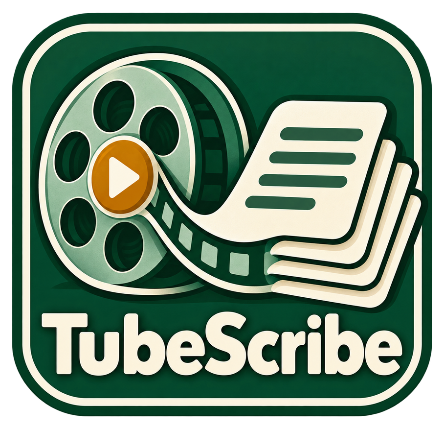

<p align="center">
  
  <br>
  <!-- repo-tagline:start -->
  <strong>📽️ Turn YouTube videos into a reading library 📚</strong>
  <!-- repo-tagline:end -->
</p>

<p align="center"><a href="https://tubescribe.tsilva.eu/">Open the library</a></p>

TubeScribe turns followed YouTube channels into a reading library. Browse
one-page summaries, speaker-labelled transcripts, and subtitles with links
back to the original timestamps.

## Try it

1. Open the library and sign in. Filter by channel or search by video title.
2. Choose a video and switch between **Summary**, **Transcript**, and **SRT
   timestamps**. A saved summary links to the source and any captured figures.
3. Use **7-day summary** to catch up or **Open full page** to read and download
   a document.

Each account has its own library. New accounts start empty. With
[processing configured](docs/guide.md#owner-selected-cloud-processing), the
owner can select **Process** or **Queue selected** and use **Retry** to resume
after a failure. The **Pipeline** tab shows progress and recorded usage.
Check the source video before relying on generated quotes or figures.

## Run your own library

Requires Python 3.11–3.13, uv, Node.js 22+, FFmpeg, and OpenSSH. From a checkout:

```bash
uv --config-file uv.toml sync --locked
scripts/tubescribe dashboard serve --port auto
```

Open the printed URL, then follow the guide to
[add channels](docs/guide.md#archive-commands). See the
[operations guide](docs/guide.md) for [installation](docs/guide.md#install),
[dashboard controls](docs/guide.md#library-dashboard), processing backends, and
[backup and restore](docs/guide.md#background-import-and-backup).
[Production delivery](docs/production-delivery.md) covers hosted deployments.

## License

[MIT License](LICENSE).
